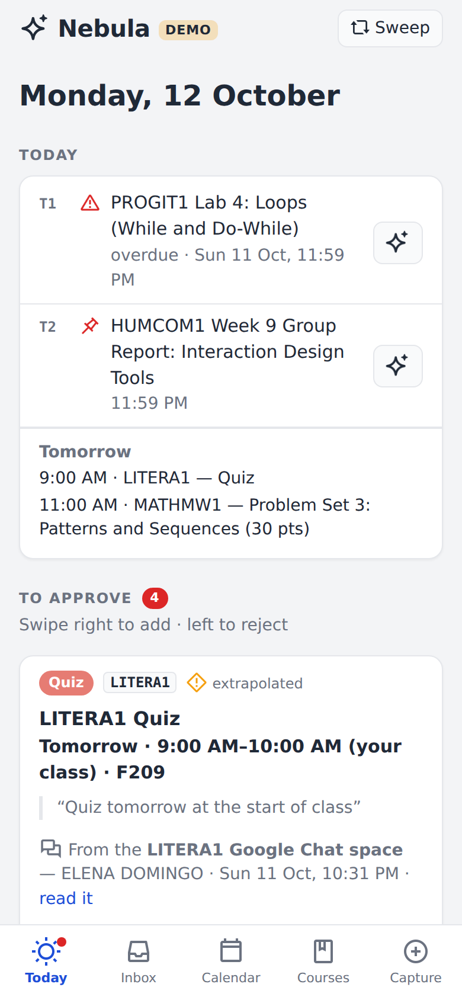
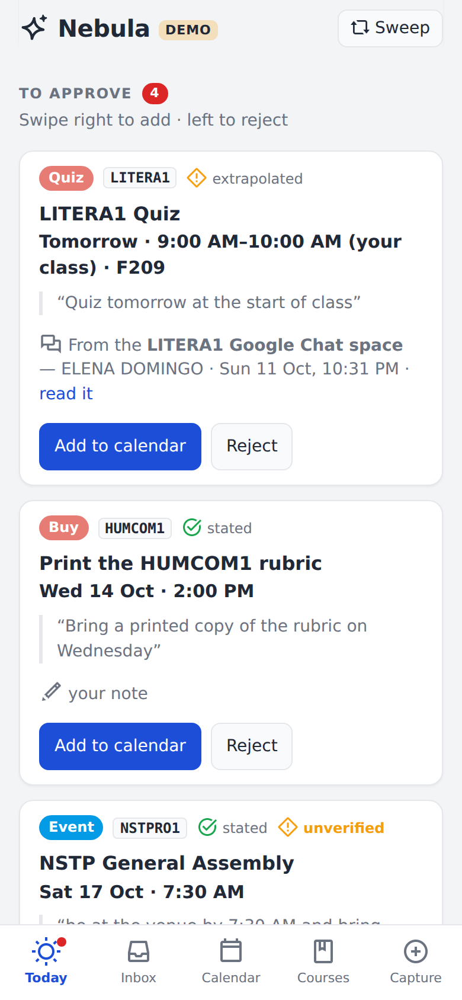
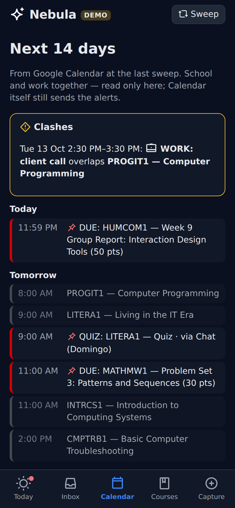
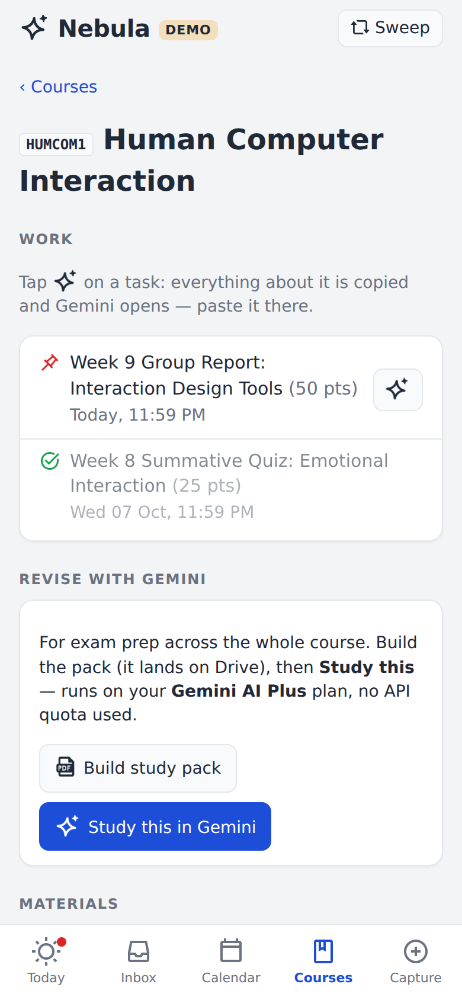
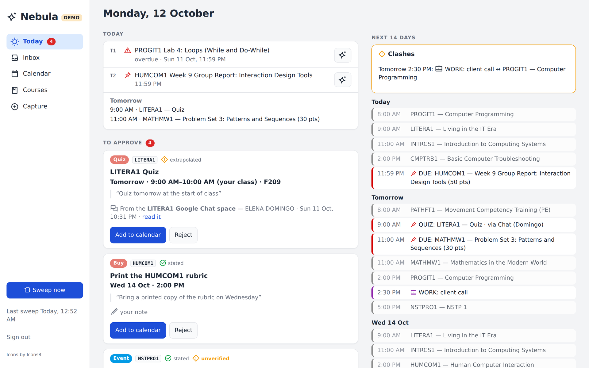
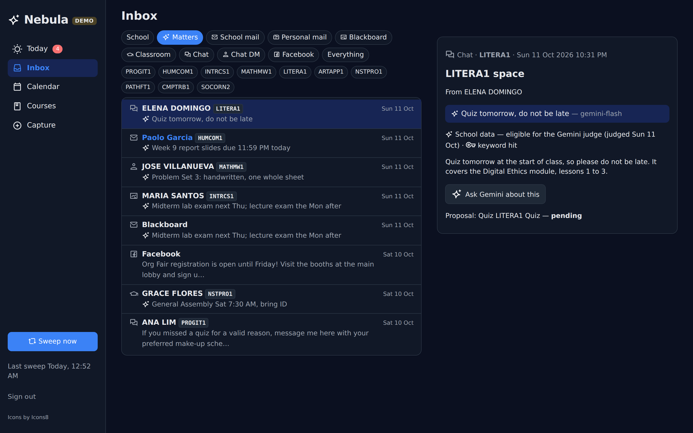

# Nebula

A small Django app that puts everything school-related in one place on my phone: what's due,
every channel's messages, the calendar, and each course. It sits on top of
[lms-deadline-sync](https://github.com/ralphalejandrino/lms-deadline-sync), which reads Blackboard,
Google Classroom, Google Chat, school mail and Facebook. Nebula adds a model that reads the free
text those channels carry and proposes calendar events, each backed by a verbatim quote.

> **A cleaned-up copy, prepared for publication.** This is a scrubbed snapshot of the app I run
> privately, published for reading. Names of people, account details and machine-specific
> paths are replaced; data, secrets and the Icons8 icons are left out. The history
> here starts at publication; the working history stays private.

<p>




</p>





_All screenshots use the built-in demo data (`manage.py demo`). Every name, message and grade in
them is invented._

## Why

The gradebook only holds part of the picture. A quiz announced in a group chat, an exam room
given in a direct message, or "bring a calculator" said in class never becomes a gradebook
column, so a deadline tracker built on the gradebook alone misses them. Nebula has a model read
those messages and turn them into proposals. A person approves each one before it reaches the
calendar.

## How a sweep works

A systemd timer ([`deploy/`](deploy)) runs one sweep four times a day, and the **Sweep now** button runs one on demand:

1. `lms.sh load --json --emit-items`: every school source, reconciled, plus every message with
   its full body.
2. `lms.sh apply --apply`: the deterministic calendar writes (DUE / OVERDUE / SUBMITTED).
3. Imports the gradebook ledger, the personal inbox (read-only) and 45 days of calendar.
4. **Judge**: new school messages go to the Gemini API (free tier, with a fallback chain across
   models), which returns tags, dated proposals with a quote, and questions only the student
   can answer.

## The rules it is built around

- **Privacy is decided by source, in one place.** `core/privacy.py` sets, on every save, whether
  a message may ever reach the model. Personal mail, classmates' direct messages and calendar
  events never do. `judge.build_payload()` checks again and fails closed. The tests include
  negative controls that prove a personal message cannot get through.
- **A proposal needs evidence.** Each one carries a quote, and the quote must appear verbatim in
  its source, or the card is marked *unverified*. A soft "preferably this week" must not become a
  hard deadline.
- **The model can add, never subtract.** The old keyword filter's hits stay visible whatever the
  model says. A message the model calls irrelevant is set aside, not hidden.
- **A failed step is UNKNOWN, never "nothing new".** If the LMS load is incomplete, the judge is
  out of quota or the network fails, the Sweep card turns red and says why.
- **Nothing reaches the calendar without a tap.** Proposals wait in *To approve*. A duplicate
  of an event already on the calendar is detected and not written twice.
- **Tutoring is a handoff, not an API call.** The sparkle button copies everything about a task
  (instructions, due date, the instructor's own words, course files) and opens the Gemini app,
  so studying spends no API quota.

## Try it with demo data

```bash
pip install -r requirements.txt
export NEBULA_DEMO=1 NEBULA_DATA=/tmp/nebula-demo NEBULA_CONF=/tmp/nebula-demo/conf
python manage.py migrate
python manage.py demo                  # wipes THIS database and fills it with fictional data
python manage.py collectstatic --noinput
python manage.py runserver             # sign in as  student / demo
```

`manage.py demo` refuses to run unless `NEBULA_DEMO=1` is set. In demo mode nothing runs in the
background: no sweep, judge or study pack. So a demo can never reach a real account.

## Running it for real

Clone [lms-deadline-sync](https://github.com/ralphalejandrino/lms-deadline-sync) and
[gws-mcp](https://github.com/ralphalejandrino/gws-mcp) next to this repo (or point
`NEBULA_LMS_DIR` / `NEBULA_GWS_DIR` at them), then set up their Google OAuth tokens as their
READMEs describe. `deploy/` has the systemd user units (gunicorn, plus the sweep timer).

| Variable | Default | What |
|---|---|---|
| `NEBULA_DATA` | `~/.local/share/nebula` | SQLite, emitted messages, study packs, logs. Holds personal mail: keep it private |
| `NEBULA_CONF` | `~/.config/nebula` | `gemini.env` (`SCHOOL_GEMINI_API_KEY=…`) and `nebula.env` (the Django key, minted on first run) |
| `NEBULA_HOST` | `nebula.local` | the hostname you serve it on (I use `tailscale serve`, tailnet only) |
| `NEBULA_PERSONAL_ACCOUNT` | `you@gmail.com` | the personal Gmail to read (read-only, never sent to the model) |
| `NEBULA_USERNAME` | `student` | pre-filled on the sign-in page; create the user with `manage.py nebula_user` |
| `NEBULA_LMS_DIR`, `NEBULA_GWS_DIR`, `NEBULA_SCHOOL_DIR` | sibling clones | where the toolchain, the Google token loader and the LMS state live |
| `NEBULA_DRIVE_OUT`, `NEBULA_MD2PDF`, `NEBULA_LMS_PYTHON`, `NEBULA_PWLIBS` | | study packs: a PDF per course, copied to Google Drive for desktop from WSL |

| Command | Does |
|---|---|
| `manage.py sweep` | one full sweep (`--no-judge`, `--no-apply`) |
| `manage.py judge` | judge pending messages only (`--captures-only` for typed notes) |
| `manage.py studypack CODE` | build a course's study pack (PDF) |
| `manage.py test core` | the suite: offline, the model and Calendar are faked |

## Layout

| Path | Job |
|---|---|
| `core/privacy.py` | the privacy rule |
| `core/judge.py`, `prompts/judge.md` | the judge: batching, schema, quote verification, dedupe against the calendar |
| `core/gemini.py`, `core/quota.py` | the single network call site, and the free-tier limits per model |
| `core/ingest.py` | the sweep |
| `core/calwrite.py` | turning an approved proposal into a calendar event, on the class slot when one fits |
| `core/tutor.py`, `core/studypack.py` | the Gemini handoff and the per-course study pack |
| `core/demo.py` | the fictional demo data |
| `core/views.py`, `core/templates/`, `core/static/` | the pages: a phone-first PWA that also works on a desktop |
| `tools/md2pdf.py` | markdown to PDF through Chromium |

## Limits, stated plainly

- It is built for **one student at one university**: the course list, the class timetable rules
  and the instructor email domain are that school's.
- The judge runs on Gemini's **free tier**, whose daily limits are small and change without
  notice. Re-check them on AI Studio's rate-limit page.
- Study packs assume WSL and Google Drive for desktop.
- The icons in the screenshots are from [Icons8](https://icons8.com). This repo ships simple
  placeholder icons in their place under the same filenames. Drop your own into
  `core/static/core/icons/` to change them.

## License

Proprietary, all rights reserved. See [LICENSE](LICENSE). Published for reading, not for reuse.
